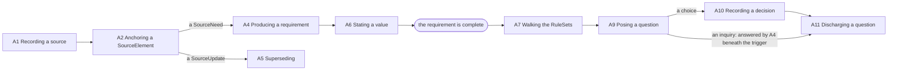

# How the project model changes

## 1. What this document is

This document states the acts through which a project model changes, and that there are no others (K150).
**A project model changes only through the acts §5 lists.** Nothing enters the model that is not the effect of
a listed act, and nothing happens to an element that no listed act does.

It is normative, and it is not a member of the collection, as `05-binding-contract.md` and `06-decisions.md` are
not (`00-overview.md` §2). It defines no element. Every element it names is defined in the member that carries it
— most of them in `02-requirement-analysis-model.md` — and this document adds nothing to what any of them is,
beyond recording K161, under which a `SourceElement` with no anchor is not well-formed (§4), and K164, under
which a `RequirementDecision` needs nothing beyond its `SourceDecision` (§5). It states only what may happen to
them, and on what condition.

**Its scope is the project model** (K151): sources, `SourceElement`s, requirements, `RequirementQuestion`s,
`RequirementDecision`s and review findings. Changing a `RequirementDefinition` or a `RuleSet` is outside it. A
rule-set is a model in its own right (K22), and whether its amendment leaves a record is its own business
(K88); a definition belongs to an implementation (K15, K16). What either change does to the requirements
already complete beneath it is OQ46.

**The list is closed, and that is the point of it.** A list of what may not happen is open by construction: a
convenient change nobody thought to forbid passes it, and it cannot show that anything is missing.
`00-overview.md` §4 makes the same observation about a list of what belongs to the metamodel — a list is
exhausted the moment somebody proposes something not on it — and that holds of a list of prohibitions. It does
not hold of a closed list of what may happen, which excludes everything it does not name.

**Two measurements follow** (K150). Whatever changes a model on a modeller's behalf is **safe** when every
change it makes decomposes into listed acts, each with its condition met, and **complete** when every listed
act can be reached through it. A list of prohibitions gives neither for certain; this list gives both.

## 2. What an act is

**An act is defined by its effect on the model** (K152): which elements, edges and states appear or cease. It
states four things — who performs it, the cause it names, its condition, and its effect (K152). §3 states who
performs the acts, since it is the same for all of them but A12 and A13, whose performer waits on OQ23, and §5
gives each act's cause, condition and effect in its columns. It names no operation, nothing supplied to one, and
no order in which operations run. An act defined by an operation would be an interface, and an interface is
implementation; defined by its effect, every entry is true of a project however that project is modelled, which
is `00-overview.md` §4's test.

**Several acts may be performed as one step**, provided the step happens whole or not at all and every act's
condition is met (K152). Recording a question that has been sent is such a step: the source carrying it is
recorded (A1), the `SourceQuestion` in it anchored (A2), and the raised question posed by it (A9), together.

**The term is *act*, and it is this collection's own** (K157): `03-project-lifecycle-model.md` §3 already speaks
of the project manager's act. W3C PROV's `Activity` is not adopted. In PROV an `Activity` is a recorded element
of the provenance graph, which is exactly the record §4 declines, and adopting the term would import that
reading. The refusal is recorded rather than left as an absence because this collection adopts a standard's
term wherever one exists (`CLAUDE.md` §3, rule 10), and a later reader would otherwise propose this one. The
collection also calls the project manager's changes to a rule-set acts (`03-project-lifecycle-model.md` §3,
K97); they lie outside this document's scope (§1, K151) and are not acts in K150's sense.

**An act's condition may enforce any syntactic constraint** (K162, K24). A check that the acts make unreachable
is not a defect. It stays stated, as the measure that whatever changes a model is held to: a model on which such
a check fails shows that whatever produced it did not keep to the acts. A check works as a worklist only where
the state it reports arises legitimately and awaits resolution — a `SourceNeed` no requirement refines yet, an
open question (`02-requirement-analysis-model.md` §11, §12).

## 3. Who acts

**Every act on the project model is performed by the modeller, a person or an agent; the project manager
performs none of them** (K153). This is the normative form of the rule that asks which actor an act belongs
to (`CLAUDE.md` §5): the modeller administers, and takes no decision about the project (K125).

**An act that commits the project names the `SourceDecision` in which the project manager stated it.** Recording a
decision (A10), and through it retiring requirements, names the `SourceDecision` in which the project manager
stated the decision (K11, K61). The project manager decides; the modeller records what was decided, from the
passage that states it. The modeller's own judgements — extraction (K40), the flag on a contradiction (K142),
relevance while walking (K86) — commit nothing.

**With no source, nothing can be committed.** The modeller, held to the acts, can commit nothing itself: the one
act that commits the project needs a `SourceDecision`, anchored in the passage of a source in which the decision
was stated (A2, K61).

Who performs a review is OQ23, and the acts over review findings (A12, A13) stay open on that point.

## 4. What an act leaves behind

**What an act produces carries its cause** (K154). A source carries no cause: provenance stops at it (K46, A1),
as it stops at a `Rule`, which carries no provenance either (K88); every chain of causes ends in one of the two.
No act produces anything else that does not name, on itself, what it came from:

- a requirement, the `SourceNeed`s it refines (K145);
- a value, the `SourceNeed` stating it (K136);
- a decision, its `SourceDecision` (K61);
- a question, its `Rule`, by *triggered by* (K87);
- a posed question, its `SourceQuestion`, by `poses` (K60);
- a discharge, the element discharging it (K79);
- a review finding, the source opening it, and once closed the later source that replies to it (A12, A13,
  K11).

**A `SourceElement` carries its anchor, and one with no anchor is not a well-formed element of this model**
(K161). The anchor is the cause A2 carries, so A2 cannot produce an element without one. An anchorless element
is not a record awaiting resolution — there is nothing in it to ask about or to weigh — so it is excluded
outright, as a `RequirementDecision` with no `SourceDecision` is (K61). This revises
`02-requirement-analysis-model.md` §5's first rule over a `SourceNeed` and §12's rule over every
`SourceElement`, which made it a failed check.

**The model records no act as an element of its own** (K154). Who performed an act, when, and in what order is
an implementation's service, if it wants one. Accountability is already derivable from what K136 states over
everything that enters. A record of each act would state every cause twice, need a check to
keep the two equal, and model the modeller rather than the project, on K88's reasoning.

**This is to be revisited if OQ44 or OQ45 is answered so that the model must know which of two changes came
first** (K154). Nothing here prevents a record of acts being added later, where one taken out again would sit
badly beside K5.

**One act removes what was there and names no cause: deleting a `SourceElement` extracted in error** (A3,
K158). That it names none is deliberate. A `SourceElement` is a pointer into a passage, and deleting the
pointer loses nothing of record: the passage stays in its source as it was given (K39). That the wrong extraction was made is not recorded either:
noticing it is the modeller's, on K40's and K41's terms, and A3 removes it. The deletion is permitted only while
no requirement or decision refines the element and no question is posed by it. Deleting one that a requirement or
a decision refines would leave that element without its origin at once (K145, K61), and deleting one by which a
question is posed would return that question to raised with nothing having caused it (K60). Whether a review
finding naming the element blocks its deletion is OQ49. K158 extends K39 from a `SourceNeed` to every
`SourceElement`, and narrows it by this condition.

**The model carries the derivability of accountability, not a record of the modeller's steps.** Every
requirement reaches the source that states it, and every decision the source in which it was taken; how the
modeller came to record them is not the project's record.

## 5. The acts

Thirteen acts, grouped by what they act on. Each condition cites the rules it rests on rather than restating
them, so that no rule is stated twice. Where a condition or a cause waits on an open question, §9 marks it.

**Over sources.**

| # | Act | Cause carried | Condition | Effect |
|---|---|---|---|---|
| A1 | Recording a source | none: the chain starts here (K46) | quoted whole and unedited (`02-requirement-analysis-model.md` §2, D45); a `replies` edge names only a source dated earlier (`02-requirement-analysis-model.md` §3, D38) | a `Source` |
| A2 | Anchoring a `SourceElement` (extraction, K40) | its anchor: exactly one passage of exactly one source | the passage is a passage of that one source (`02-requirement-analysis-model.md` §4, §12, D26, K161) | a `SourceNeed`, `SourceUpdate`, `SourceDecision` or `SourceQuestion` |
| A3 | Deleting a `SourceElement` extracted in error | none, deliberately (K158, K41) | no requirement or decision refines it, and no question is posed by it (K158); whether a review finding naming it blocks deletion is OQ49 | the element ceases; the source is untouched |

**Over requirements.**

| # | Act | Cause carried | Condition | Effect |
|---|---|---|---|---|
| A4 | Producing a requirement | at least one `SourceNeed` it refines (K145); every value stated by one of them (K136) | its definition is not abstract (K109); a derivation names only originals that already exist, so it closes no cycle (K147, K163) | a `Requirement` in force; where it elaborates others, its derivation edges to them (K146, K147); inseparably, a `RequirementClarification` for each parameter without a value (K155); if every parameter has a value, its finished text, computed from the template (K111, K140), and its walk falls due (K128) |
| A5 | Superseding, a form of A4 | also a `SourceUpdate` it refines, and `supersedes` naming at least one requirement (K133) | whether each superseded requirement must be in force is OQ44 | inseparably, the new requirement enters force and the superseded leave it (K155); values carried over keep their source (K138) |
| A6 | Stating a value | the `SourceNeed` stating it, which the requirement then refines (K136) | the requirement is incomplete (K129, K140) and the parameter has no value (K137, K139) | the requirement refines the stating `SourceNeed` (`refine` is list-valued, `02-requirement-analysis-model.md` §11); the value; the parameter's clarification, if open, closes, which is computed (K143); if the requirement becomes complete, its finished text, computed from the template (K111, K140), and its walk falls due (K128) |

**Over questions, decisions and findings.**

| # | Act | Cause carried | Condition | Effect |
|---|---|---|---|---|
| A7 | Walking the `RuleSet`s that reach a requirement (a judgement, K86) | the `Rule`, by *triggered by*, and the triggering requirement | the requirement is complete (K128, K140); the rule reaches it (K69), is in force and its guard does not exclude it (K97, K105). The walk falls due once, when the requirement becomes complete (A4, A6); carrying out every reaction, one noticed late included, is the modeller's on K41's terms (K159) | where the rule is judged relevant and its firing test fires (`03-project-lifecycle-model.md` §3, K74, K148): a `RequirementChoice` (`ConflictRule`) or a `RequirementInquiry` (`CompletenessRule`, at most one open per rule and triggering requirement, K148); a rule judged not relevant leaves nothing (K159) |
| A8 | Raising a contradiction choice | the parameter's `ValueRule` and the requirements of one kind that contradict (K141); the modeller's flag (K142) | a requirement is a triggering requirement of at most one open choice per parameter (`02-requirement-analysis-model.md` §12) | a `RequirementChoice`, or, where one is already open over a requirement the new one contradicts, that choice extended: its triggering requirements and candidate alternatives grow, and no second choice opens (K78, K141, `02-requirement-analysis-model.md` §11); with A4, or later |
| A9 | Posing a question | the `SourceQuestion`, by `poses`, in the source carrying the question sent | the question is raised (K60, `02-requirement-analysis-model.md` §11) | the question is posed (K60) |
| A10 | Recording a decision, which commits the project (K153) | at least one `SourceDecision` (K61) | `retires` names only requirements in force when the decision is produced (`02-requirement-analysis-model.md` §12, K62). Nothing else is required of it: its `SourceDecision` is all a decision needs (K164) | a `RequirementDecision`; inseparably, the requirements it retires leave force (K155) |
| A11 | Discharging a question | the discharging element: for an inquiry, a requirement in force of the implied kind, produced deriving from the trigger (K148, K163, `03-project-lifecycle-model.md` §3: a retired requirement does not fill a gap); for a choice, a decision | — | a `discharges` edge. A clarification is not discharged; its value closes it (K143) |
| A12 | Opening a review finding | the source opening it | it names at least two elements (K10); who performs it is OQ23 | an open finding |
| A13 | Closing a review finding | a later source that `replies` to the one opening it (K11) | — | a closed finding |

**A derivation enters only with the derived requirement, from originals that already exist** (A4, K163). A
requirement that exists gains no further original. A later piece of information creating a cycle, or an
earlier requirement coming to derive from a later one, would be a paradox in the project model's causal
structure. Where a later triggering requirement implies what an existing one already says, the client's answer
restating it is a repetition of what is known, and it is refined into a requirement of its own beneath the
later trigger, which discharges that trigger's inquiry (A11). The acyclicity K147 asks of derivation then
follows from the order things arrive in, not from a check. This narrows K147, which let a derivation be added
to a requirement that exists, and revises K148 to match; OQ42, which asked what states such an added
derivation, dissolves, since no edge is added later.

**A decision needs nothing beyond the `SourceDecision` it is produced from** (A10, K164). The model requires
derivability to sources, not that everyone justify everything. Who decided and when are the source's to carry,
and a decision carries its other attributes (`02-requirement-analysis-model.md` §11) where its source states
them. The failed check over a decision's five attributes is withdrawn. Which attributes a source must carry is
OQ50.

The diagram draws what this section states; where the two disagree, the prose wins.

## 6. Inseparable acts

**Three acts are inseparable from part of their effect** (K155), because each half alone would leave the model
in a state no rule admits. Each pairing follows from rules already stated; what the decision adds is that the
two halves are one step, so that nothing performing the acts can leave the first without the second.

1. **Producing a requirement opens a `RequirementClarification` for every parameter without a value** (A4,
   A5). It follows from K119 and K143, and from `02-requirement-analysis-model.md` §12's rule over when a
   clarification is open.
2. **A requirement superseding others takes them out of force as it enters** (A5). It follows from K133 and
   K144.
3. **A decision retiring requirements takes them out of force as it is recorded** (A10). It follows from K62
   and K144.

These are not several acts performed as one step (§2), where each act could stand alone. Here neither half is
an act by itself: there is no act that opens a clarification, and none that takes a requirement out of force,
except as part of these three.

## 7. What is not an act

**Reading is not an act** (K156). Querying, checking and the projection (`02-requirement-analysis-model.md`
§10) change nothing in the working model and stand outside the list.

**Cutting a baseline is not an act** (K156, `01-requirement-model.md` §4). A baseline is the projection given
identity — an export — and not a step to be audited or committed to. No source states it, and a new one is cut
whenever later information calls for it. Requiring a source for each cut would introduce a source kind for an
act that commits nothing the working model does not already hold. K142's condition, that every contradiction
choice is decided before a baseline is cut, stays a condition on the export. SysML v2 likewise has no element
for a baseline, as OQ37's comparison records.

**Creating a project model is not an act on it** (K160). It brings into being the model the acts change, and
produces no element of it: no source, no `SourceElement`, no requirement. It is not reading either, which is
why it needs a line of its own.

**A walk leaves no trace beyond the questions it raises** (K159). A7 is an act for what it raises; whether a
walk ran is not a fact the model records. A walk is the reaction to an event the model does record, a
requirement becoming complete (K128), so the event is its record. That every reaction was carried out is the
modeller's, on the terms K40 and K41 hold extraction to, and `03-project-lifecycle-model.md` §3 already
declines to guarantee that a walk is exhaustive.

## 8. What no act does

These are stated as the other face of K150, so that a reader proposing one of them finds the refusal rather
than an absence.

- No act deletes a requirement (K5).
- No act takes a requirement out of force other than by a decision or a supersession (K144).
- No act changes or removes a value once stated, whether or not the requirement is complete (K129, K137,
  A6). A correction is a supersession (A5, K129, K133), and a different value stated without replacing
  anything is a requirement of its own and a contradiction choice (A4, A8, K139).
- No act returns a requirement to force; one wanted again is produced anew from the source that asks for it
  (K144, A4).
- No act raises a question with no rule (K87).
- No act records a decision with no `SourceDecision` (K61).
- No act edits a source (`02-requirement-analysis-model.md` §2, D45).
- No act moves an anchor; a `SourceElement` anchored wrongly is deleted (A3), on A3's condition, and anchored
  again (A2).
- No act deletes a question, a decision or a finding (K10, K150).
- No act adds an original to a requirement that exists; a derivation enters only with the derived requirement
  (A4, K163), and a later trigger's inquiry is discharged by a requirement produced beneath it (A11).
- No act removes an edge once it has entered, except as A3 may when it deletes the element at one end of it.
  A3 removes a `SourceElement` with its anchor, and only while no requirement or decision refines it and no
  question is posed by it (K158). Whether a review finding naming the element keeps it from being deleted is
  OQ49.
- No act closes a finding directly (K11).

## 9. What is open

The list closes over what is decided, and each act marked here keeps the condition or cause the open question
leaves.

| Act | Waits on |
|---|---|
| A3 | OQ49: whether a review finding naming the element keeps it from being deleted |
| A4's clarification | OQ38: whether a parameter's ask is a `ValueRule` at all |
| A5 | OQ44: whether each superseded requirement must be in force |
| A7 and A8 | OQ41: whether a choice a `ConflictRule` raises is one over contradicting requirements; OQ45: which requirements a `ConflictRule`'s test reaches when the walk runs once; OQ48: whether a decision that a contradiction is not real is among a choice's candidate alternatives |
| A8's cause | OQ38: whether the parameter's ask is a `ValueRule` |
| A10's source | OQ50: which attributes a `Source` must carry, its party and its date among them |
| A11's cause, for an inquiry | OQ40: whether only a requirement deriving directly from the trigger discharges it; OQ26: whether a negative answer is a requirement |
| A12 and A13 | OQ23: what a review is, as an act, and who performs it |
| §7's baseline | OQ35: whether a baseline may be cut while a requirement in force is incomplete |
| §1's scope | OQ46: what a change to a `RequirementDefinition` or a `RuleSet` does to the requirements already complete beneath it |
| No act: closing a `RequirementDecision` | K63: a decision carries an open or closed state, and what closes one is unstated, so no act closes a decision until that criterion is |
| No act: closing a review finding by a decision | K49, K63: which review finding a `RequirementDecision` closes waits on the Project Lifecycle Model |
| No act: closing a `RequirementInquiry` or `RequirementChoice` whose triggering requirements have left force | OQ43 |
| No act: anything done to the requirements deriving from one that has left force | OQ39 |
